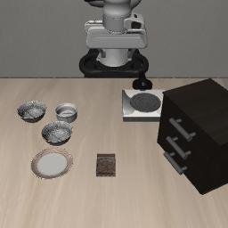
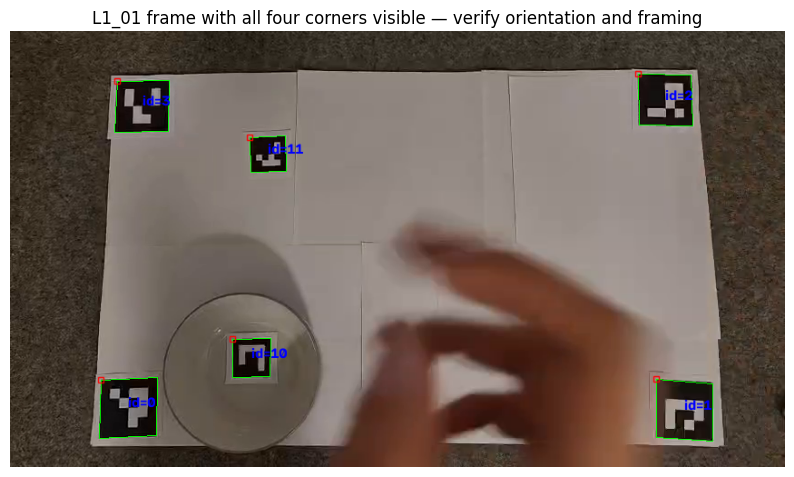
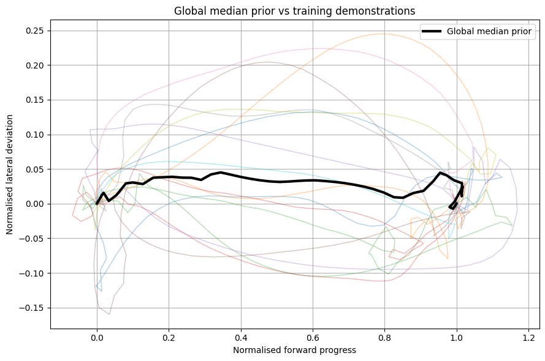
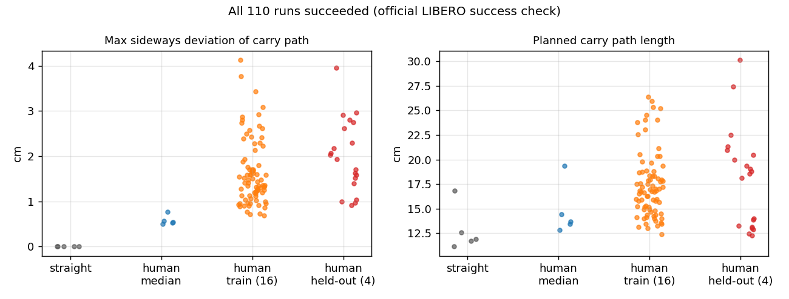

# Hand2Panda

Phone videos of my own hand moving an object on a table → metric 2D trajectories → a human "motion prior" → a Panda arm in LIBERO carrying a bowl along those human paths.



*Panda in LIBERO (`libero_spatial`, task 0: "pick up the black bowl between the plate and the ramekin and place it on the plate"). Carry path here is a straight line; the same runner is driven by human paths below.*

## Summary

- I recorded **20 phone videos** of an object being moved to a target on an instrumented table (16 for fitting, 4 held out).
- I turned them into metric table-frame trajectories **without any learned hand tracker**, using ArUco markers, a homography, and a perspective correction.
- I normalised the paths, fitted a median "motion prior" on the 16 training videos, and **retargeted all 20 human paths** (plus the median and a straight-line baseline) to a Panda arm in LIBERO.
- **All 110 simulated runs succeeded** (22 carry paths × 5 initial states, official LIBERO success check). That includes the 4 held-out demos.


## How it works

### 1. Capture and extraction (`notebooks/01_video_to_motion_prior.ipynb`, `src/extract_tracks.py`)

The table has four ArUco corner markers (IDs 0–3, 70 × 36 cm layout). The moved object carries marker ID 10 and the target carries ID 11. A phone filmed the table from about 65 cm above.



- **Homography** from the corner markers maps pixels to table coordinates (metres).
- **Perspective correction:** a marker lifted off the table looks bigger and shifts in the image. The ratio of its apparent size to the table markers' size gives its height, which is used to correct its XY position.
- Gaps are interpolated, the signal is Savitzky–Golay smoothed (~0.2 s), and the carry segment is found from the object's own motion (1.5 cm threshold).
- Each video gets a QC report. 13/20 passed all automated checks. 7/20 ended more than 6 cm from the target marker (calibration and marker-placement error, not necessarily a failed demo). I kept them and report this, rather than loosening the check.

### 2. Motion prior

Each carry path is resampled to 50 points by arc length and expressed in the demo's own start→goal frame: `along` (progress / goal distance) and `lateral` (sideways / goal distance). This makes shape comparable across layouts and distances. The prior is the point-wise median of the 16 training paths.



### 3. Retargeting into LIBERO (`notebooks/02_libero_retargeting_eval.ipynb`)

- The normalised path is mapped onto the simulator's bowl→plate XY displacement (11.7 cm).
- The arm is driven by a closed-loop Cartesian controller. Its action→motion Jacobian is **measured** by probing each axis with a small command, not assumed.
- Approach, grasp, lift, lower and release are **geometric**. Only the XY shape of the carry comes from the phone videos. The height estimates from video were not reliable, so I did not use them.
- After the lift, the bowl's offset inside the gripper (about 4 cm) is measured and subtracted from every carry and place target.

## Results

Evaluation: 22 carry paths × 5 LIBERO initial states = 110 runs. Success is `check_success()` after release and 20 settle steps. Data: `results/eval_results.csv`.

| Carry path | Runs | Held bowl | Success | Bowl–plate error | Max sideways deviation* | Path length* |
|---|---|---|---|---|---|---|
| Straight line | 5 | 100% | 100% | 0.97 cm | 0.00 cm | 12.8 cm |
| Human median | 5 | 100% | 100% | 1.00 cm | 0.58 cm | 14.8 cm |
| Human, 16 training demos | 80 | 100% | 100% | 0.97 cm | 1.64 cm | 17.4 cm |
| Human, 4 held-out demos (L5/L6) | 20 | 100% | 100% | 0.90 cm | 2.01 cm | 18.1 cm |

\* planned XY carry path in simulator coordinates, not measured from the executed motion.



**Stress test** (`results/lateral_stress_test.csv`): scaling the median's sideways component ×5, ×10, ×20 (up to ~15 cm sideways on an 11.7 cm move) still succeeded in 15/15 runs. The carry is very tolerant of path shape.

**Does the prior describe unseen paths?** (`results/heldout_analysis.txt`) RMS distance between normalised paths, as a fraction of goal distance (lower is closer):

| | Median prior | Straight line |
|---|---|---|
| Held-out L5/L6 (4 demos) | 0.161 | 0.167 |
| Leave-one-out, training (16 demos) | 0.130 | 0.145 |

The median is only slightly closer than a straight line, and it is closer for the L6 demos but farther for L5. With 4 held-out demos I do not claim this is significant. Demo-to-demo variation (lateral std about 8% of travel) is larger than the shared shape.

## What worked and what didn't

**Worked**
- Marker-based extraction gave usable 2D paths from ordinary phone video.
- Measuring the controller Jacobian instead of assuming it made the arm behave predictably.
- Disabling camera rendering (the evaluation doesn't use images) cut a run from ~125 s to ~11 s.

**Didn't work, and what I changed**
- My first runner failed (success `False`) and reported a bowl–plate distance identical to the start. Two causes: object positions were read from a cached simulator handle that goes stale after `env.reset()`, and the carry ignored that the bowl sits ~4 cm off-centre in the gripper, so it was placed off the plate. The failed run is kept in `media/early_failed_attempt_straight.gif`. Fixing both gave the results above.
- Video-derived lift heights (3.8–20 cm for the same kind of move) were not plausible, so they are excluded.

## Limitations

- One LIBERO task and five initial states. The grasp offsets were tuned on state 0.
- Only 2D path shape is learned. Everything else is hand-coded.
- 7/20 videos have endpoint QC warnings; target-marker detection is only 34–63% of frames; camera height is a measured estimate.
- Human travel (18–41 cm) is rescaled to the simulator's 11.7 cm.
- The task cannot discriminate between path shapes, so no claim is made that human paths improve performance.

## Run it

Colab (CPU is enough; the evaluation takes about 20 minutes without camera rendering).

1. Put the 20 videos named `L1_01 … L4_04, L5_01, L5_02, L6_01, L6_02` in a Drive folder and set the paths in the first cell of `notebooks/01_video_to_motion_prior.ipynb`. Run it top to bottom. It writes trajectories, QC reports, the normalised paths and `motion_prior.npz` to `clean_pipeline_outputs/`. The outputs from my run are in `data/`.
2. Run `notebooks/02_libero_retargeting_eval.ipynb` top to bottom. The first cell installs LeRobot v0.6.1 with LIBERO. It reads the prior from `clean_pipeline_outputs/normalized_dataset/`.
3. To regenerate the table and figure: `python scripts/make_summary.py`.

Single video from the command line: `python src/extract_tracks.py VIDEO.mp4 --out out/L1_01.npz --cam-height 0.65`.

## Repo layout

```
notebooks/   01 video → motion prior · 02 LIBERO retargeting + evaluation
src/         extract_tracks.py (marker-based trajectory extractor)
scripts/     make_summary.py
results/     eval_results.csv · summary_by_group.csv · heldout_analysis.txt · lateral_stress_test.csv
data/        extracted trajectories, QC reports, normalised paths, motion prior (from my videos)
media/       GIFs and figures used above
```

Environment of my run: Colab CPU, Python 3.13, LeRobot 0.6.1, robosuite 1.4.0, hf-libero 0.1.4, MuJoCo 3.8.1.
